<!-- /** @file README.md @brief Egret Physics 的功能总览、静态演示、版本更新、构建运行与文档导航。 */ -->

# Egret Physics


**面向力学场景搭建、数值仿真、结果回放与数据分析的桌面实验工具。**

在同一套 Qt Quick 界面中创建刚体、力场和约束，配置条件规则或受限 C 控制程序，离线求解生成 EPSX，再通过三维回放、曲线、频谱、拟合和理论方程对照检查结果，最后导出表格或视频。

[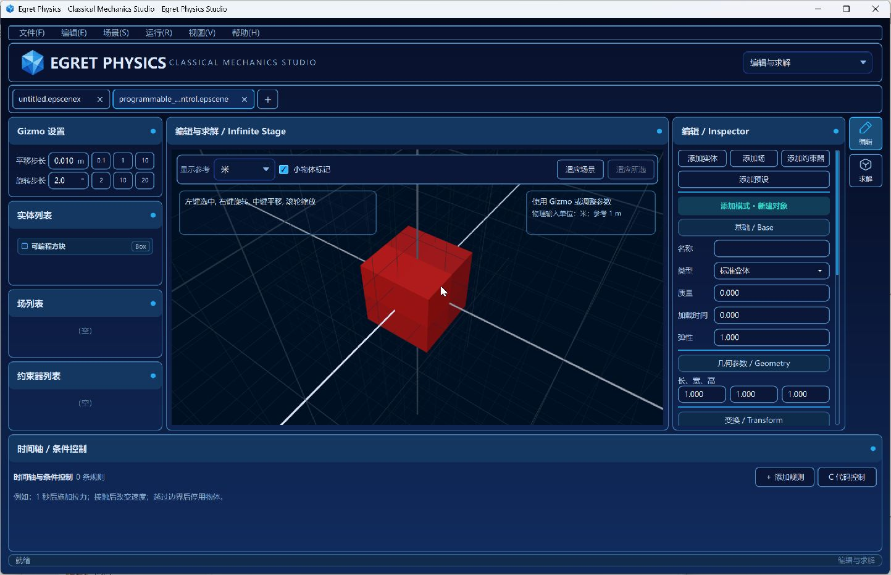](README.assets/v2_editor.jpg)

[功能总览](#功能总览) · [功能演示](#功能演示) · [版本更新](#版本更新) · [快速开始](#快速开始) · [构建与依赖](#构建与依赖) · [文档导航](#文档导航)

本轮新增受限 Lua 控制后端，与谓词规则、C/Wasm 共用控制抽象及动作接口。使用方法见 [受限 Lua 控制说明](docs/interpreted_scene_control.md)。

## 功能总览

| 模块 | 当前能力 |
| --- | --- |
| 刚体与物理场 | 球体、盒体、圆柱、圆盘、杆、圆环、壳体等几何；质量、姿态、速度、角速度、材质；重力、质心引力等场 |
| 碰撞与摩擦 | GJK/EPA 与 CCD 相关碰撞流水线、多点接触、接触图／碰撞岛、静摩擦与动摩擦、休眠及唤醒 |
| 约束 | 连接线、连接杆、弹簧、滑轨、支撑面等；线／杆可绑定固定空间锚点 |
| 场景编辑 | 多文档、属性编辑、Gizmo、平移／旋转步长、复制粘贴、撤销重做、七项可叠加预设 |
| 显示与时序 | 厘米／米／千米／自定义参考尺度、小物体标记、适应场景／所选、对象加载时间、中文条件规则 |
| 离线求解 | 可配置物理步长、文件采样间隔及求解时长，后台任务与取消，GUI 和命令行入口 |
| 结果回放 | EPSX 三维回放、暂停、逐帧、时间跳转与倍速；动态实体创建／销毁后的恢复 |
| 数据分析 | 按实体和通道抽取数据、二次抽帧、时域曲线、缩放／平移／框选、区间分析、XLSX／CSV 导出 |
| 拟合与理论对照 | 线性、多项式、三角函数、指数、对数拟合；自定义理论方程及常量，叠加曲线与误差统计 |
| 频域分析 | FFTW 傅里叶变换、单边幅度谱、可选相位谱、频谱缓存及后台绘图数据准备 |
| 视频导出 | 从 EPSX 导出 MP4；命令行提供分辨率、帧率、相机、编码后端及编码器选项 |
| **v2.0 可编程控制** | **多段受限 C 源码、对象别名、数值参数、控制周期、独立状态、后台检查、模板创建与永久销毁** |

主要使用“编辑与求解”“播放器”“数据分析”三个工作区。旧“实时仿真”入口保留，界面已标注不再维护。

物理计算和属性输入采用 SI 单位，Z 轴向上。显示参考尺度只改变呈现，不改变物体实际尺寸、质量、力或时间步长。

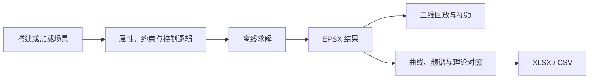

## 功能演示

以下十张当前界面截图均于 **2026-11-08** 从项目实际程序采集；每张都可点击查看原图。使用的场景、采样条件与截图范围见 [截图记录](README.assets/screenshot_notes.md)。界面操作演示与数值精度验证分别说明。

### 1. 场景编辑与显示尺度

首页截图展示 [可编程方块示例](demo/programmable_body_control.epscene)：左侧管理实体、场及约束，中间进行三维观察，右侧添加或编辑物体，下方进入条件控制和 C 控制。

- 左键选择，右键拖动旋转，中键拖动平移，滚轮缩放；Gizmo 的平移和旋转步长可调。
- 参考尺度提供厘米、米、千米和自定义，配合小物体标记及“适应场景／所选”观察不同数量级的场景。
- 物体属性包括质量、加载时间、恢复系数、摩擦系数、几何、初始速度和角速度等。修改后保存场景，再发起求解。

### 2. 叠加预设，快速搭建实验

点击右侧“添加预设”，可选择标准重力场、大型地平面、标准测试场景、摩擦地面、单摆、弹簧振子或自由落体球。

[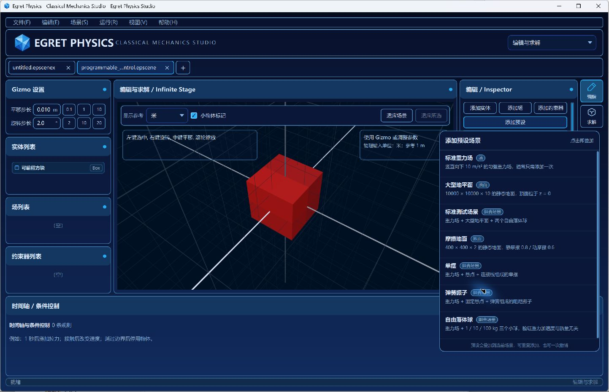](README.assets/v2_presets.jpg)

大型地平面的尺寸为 `10000 × 10000 × 10`，中心为 `(0,0,-5)`，质量为零，顶面位于 `z=0`。标准重力沿 Z 负方向，大小为 `10 m/s²`。

添加预设保留已有内容，重新分配 ID、重映射约束引用，并处理重名；整组添加可一次撤销。重复加入含重力的组合预设会累计重力，添加后应检查场列表。单摆预设采用固定悬点与连接线建模。

### 3. 中文条件规则

简单控制可以通过表单完成，无需编写代码。点击“添加规则”，选择条件、组合方式、触发方式和动作。

[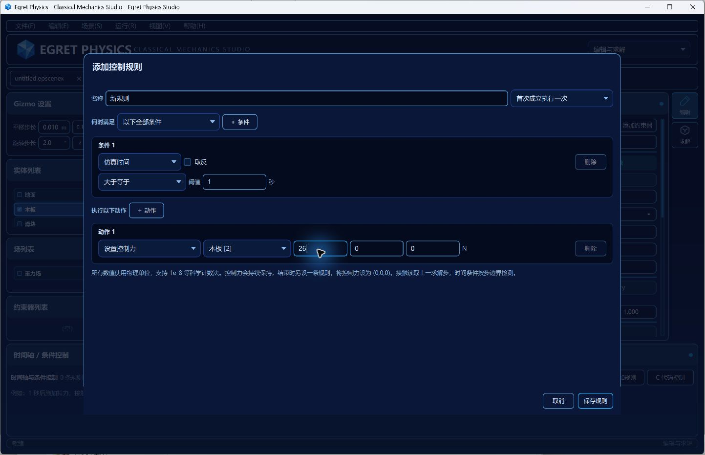](README.assets/v2_condition_rule.jpg)

图中是临时配置的规则草稿：仿真时间达到 1 秒后，向木板设置 `(26,0,0) N` 控制力，首次成立执行一次。条件可以组合为“全部满足”或“任一满足”，也可以取反；支持位置、速度、相对量、距离、接触及状态等判断。

控制力会持续保持，结束施力需再设置零向量。条件在物理步边界检测，不代表连续时间中的精确事件定位。截图草稿未写回示例文件。

### 4. 受限 C 控制：绑定、参数与编译检查

从“场景 → C 控制程序”或底部“C 代码控制”打开编辑窗口。先绑定对象别名和数值参数，再编写 `void on_step(void)`，设置周期、开始／结束时间，点击“检查当前草稿”。

[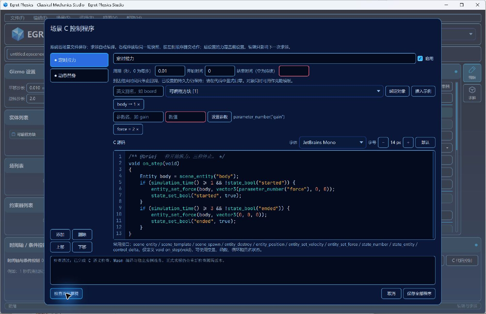](README.assets/v2_control_code.jpg)

图中 `body` 绑定可编程方块，`force=2`，控制周期为 `0.01 s`：1 秒开始施力，3 秒撤销。编辑器支持 C 高亮、行号、四空格自动缩进和字体字号设置，默认使用 JetBrains Mono。

“检查当前草稿”不会替代保存；点击“保存全部程序”并保存场景后，正式求解会重新检查捕获的场景版本。各程序拥有独立状态，按列表顺序运行。

### 5. 模板创建与永久销毁

同一场景中的第二段程序展示动态生命周期：3.2 秒从初始模板创建替身并设置速度，4 秒销毁原体。

[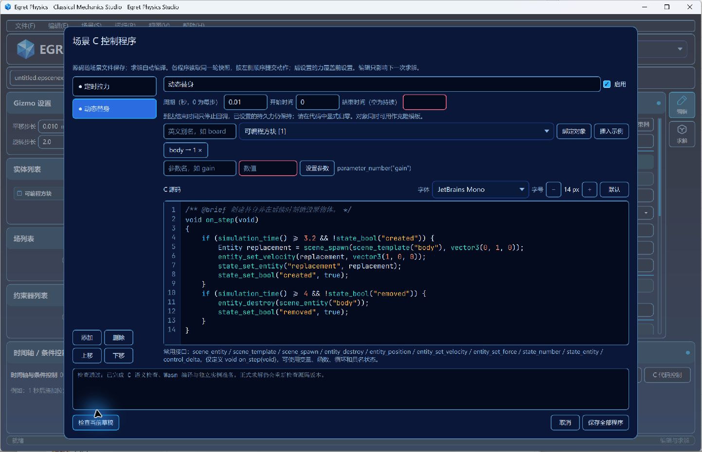](README.assets/v2_control_lifecycle.jpg)

模板保留初始物体的几何、质量、材质和渲染配置。新实体可在创建回调内继续配置；有关联约束或共享力源等不支持情形时，销毁会报错，不能隐式级联删除。

### 6. 回放动态实体的变化

重新求解上述示例后，在播放器跳到 **3.48 s** 并“适应场景”，可以同时看到原方块与新建替身：

[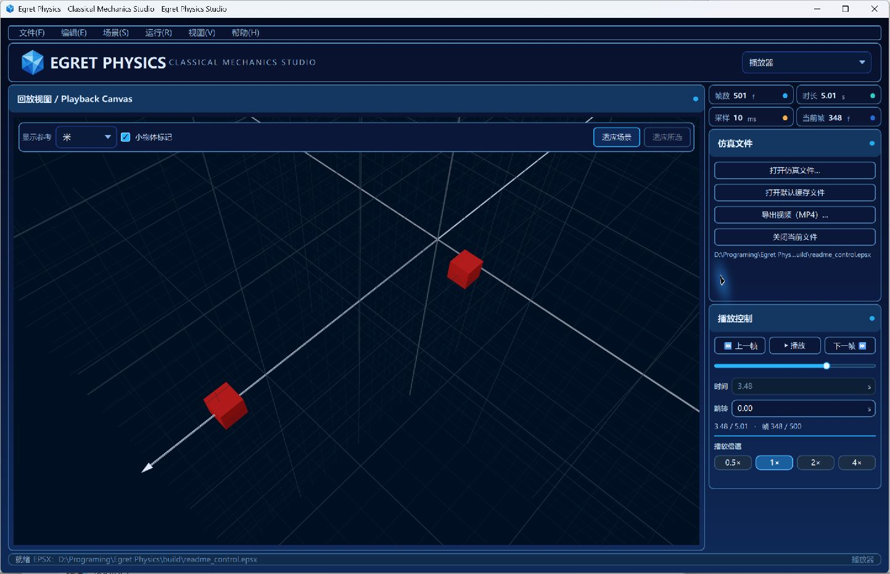](README.assets/v2_playback_spawn.jpg)

跳到 **4.48 s**，原体已经销毁，画面只保留替身：

[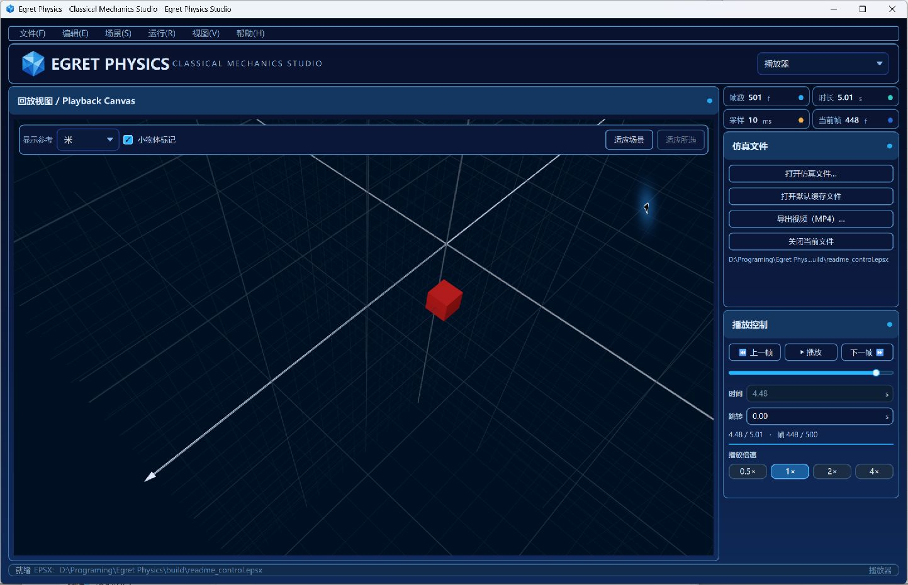](README.assets/v2_playback_destroy.jpg)

播放器按 EPSX 记录恢复稳定身份与生命周期，支持向前、向后及随机跳转，不重新执行 C 控制程序，也不要求控制编译器参与回放。

### 7. 数据抽取与时域波形

打开 EPSX 后切换到“数据分析”，勾选实体和数据通道，选择抽帧比并点击“开始抽取”；在右侧序列列表中选择曲线。

[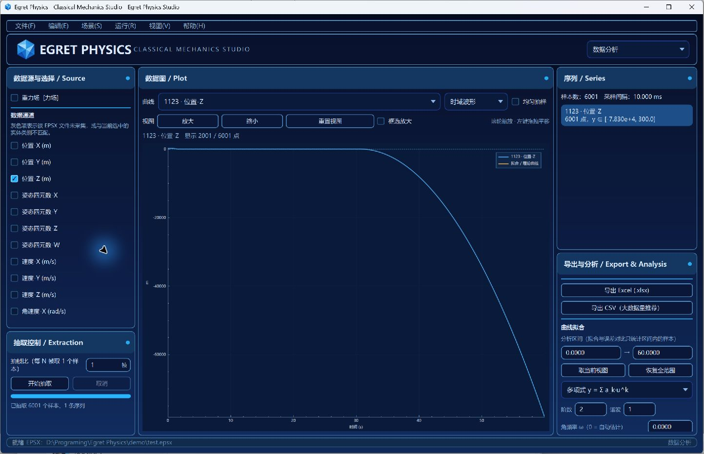](README.assets/v2_analysis_time.jpg)

图中使用仓库已有的 [demo/test.epsx](demo/test.epsx)，选择实体 `1123` 的位置 Z，原采样间隔为 `10 ms`，抽帧比为 1，共 6001 个样本。该图演示数据操作，不作为当前求解器的精度基准。

曲线支持滚轮缩放、拖动平移、框选与重置视图。右侧提供五类拟合、分析区间、理论方程对照和 XLSX／CSV 导出。实际可用通道取决于 EPSX 是否采集了相应数据，未采集通道不能按真实零值理解。

### 8. 幅度谱与相位谱

把图形类型从“时域波形”切换为“频域频谱”，默认显示幅度谱；勾选“显示相位谱”后，上下显示幅度和相位。

[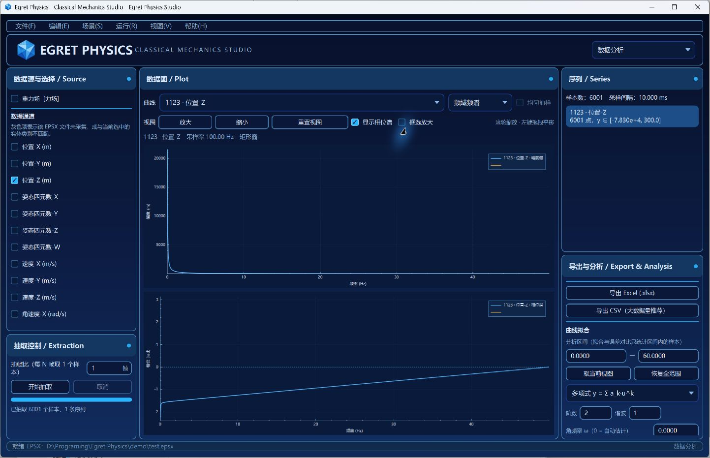](README.assets/v2_analysis_spectrum.jpg)

当前采用矩形窗，按实际均匀采样间隔计算频率轴，频谱结果可缓存复用。改变抽帧比会改变有效采样率；非周期趋势、直流分量和窗口泄漏也会影响图形。截图中的信号不是单一正弦，不能把低频能量直接解释为某个机械振动频率。

### 9. 视频导出

在播放器打开 EPSX、调整观察相机后点击“导出视频（MP4）”，设置帧率和偶数宽高，再选择输出位置。

[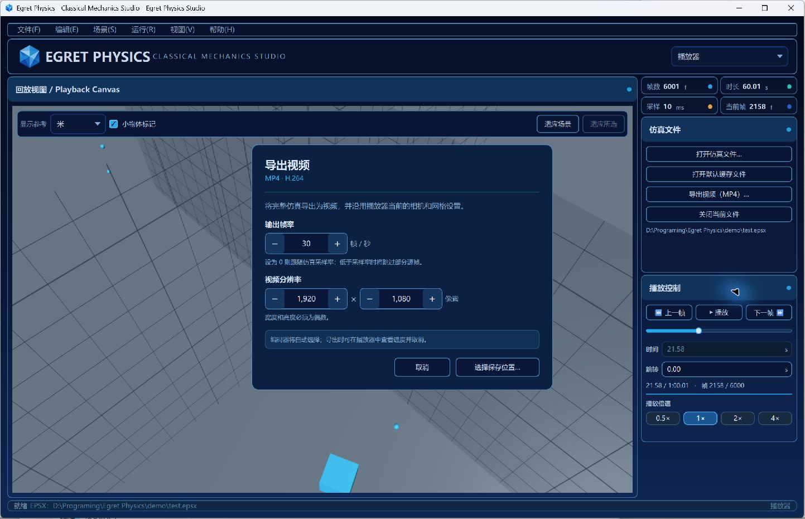](README.assets/v2_video_export.jpg)

GUI 导出完整仿真并沿用播放器当前相机和网格设置；命令行还提供编码器、质量、后端和相机参数。硬件编码可用性取决于本机设备与运行库，详见 [视频导出说明](src/view_model/video_export/README.md)。

## 版本更新

以下按项目功能阶段归纳：**v1.0 是本轮持续迭代之前的原始基线，v1.1 汇总此后的主要完善，v2.0 以受限 C 语言控制注入为核心升级。** 项目版本与场景归档版本、EPSX 数据版本分别管理。

| 版本 | 定位 | 主要变化 |
| --- | --- | --- |
| **v1.0** | 原始基线 | 已有刚体、场、约束、策略式求解器、Qt Quick 三维界面与原始编辑／仿真流程 |
| **v1.1** | 主要功能迭代与稳定性完善 | 接触图与多点接触、碰撞及摩擦修复、约束锚点和加载时序、编辑器完善、离线结果工作流、数据分析与频谱、视频导出、显示尺度和条件规则 |
| **v2.0** | 可编程控制 | 多段受限 C、Clang→Wasm→Wasmtime、对象绑定和参数、状态及调度、模板创建销毁、动态结果回放；配套代码编辑器、叠加预设和 V2 场景归档 |

### v1.1：主要迭代

- **物理稳定性**：完善平面接触法线与多点流形、接触岛内求解、摩擦圆锥、CCD 候选与 TOI、恢复及位置修正；修复惯量和累加器初始化、零主惯量处理、支撑休眠及受力唤醒。
- **摩擦与约束**：打通静摩擦／动摩擦属性；改善线和杆的单侧约束及固定端处理，支持虚拟固定锚点；旧单摆场景可转为固定锚点连接线。
- **场景与时序**：贯通实体、力场和约束的加载时间，修复场源状态和 ID 冲突；完善属性回填、批量复制引用重映射和撤销历史。
- **实验工作流**：完善场景离线求解、EPSX 保存回放及视频输出；提供显示参考尺度、小物体标记和中文时间／条件规则。
- **数据分析**：按实体和通道抽取、LOD 绘图、XLSX／CSV 导出、五类拟合、理论表达式与区间误差对照；新增 FFTW 幅度／相位分析及缓存、后台计算和刷新优化。
- **验证示例**：补充平面接触与阻力、混沌摆、滑块木板等场景和回归。物理误差需按具体场景、步长及建模假设评估，不能由某个示例推广到全部场景。

接触修复的测量与边界见 [接触验证](docs/ContactGraphValidation.md)；滑块木板的解析解、薄板极限及误差见 [教学题复现](docs/sliding_block_board.md)。

### v2.0：受限 C 语言控制注入

- **编辑与保存**：场景内嵌一段或多段源码，支持程序排序和启停、稳定对象别名、数值参数、周期及有效时间段；草稿后台检查与正式求解分别校验。
- **受约束执行**：Clang AST 白名单与调用图检查，编译为 Wasm 后由 Wasmtime 执行；固定内存、fuel 和动作预算，宿主校验后统一提交动作。
- **领域能力**：读取刚体状态，修改位置、速度、角速度、质量、姿态和材质，设置持久力／力矩、启停实体，利用模板创建和永久销毁；支持具名状态及有界集合／序列。
- **结果生命周期**：EPSX 记录动态身份、控制动作和材质变化，播放器支持动态对象恢复、倒放和跳帧；修复旧结果中辅助锚点误删及约束引用失效。
- **编辑器配套**：深蓝主题 C 编辑窗口、JetBrains Mono、语法高亮、自动缩进、七项叠加预设；整理六类菜单、快捷键、文本焦点冲突和未保存退出提示。
- **场景归档**：新增 `.epscenex` ZIP，把实体、场、约束和 `control/*.c` 分开存储；继续读取和保存旧 `.epscene` JSON。

当前公开编程能力集中于刚体控制。力场和约束仍由原有 UI 配置，智能体接入、独立模板库及积分器内部纯函数力回调尚未开放。

### v1.0 历史界面

以下保留原 README 的三张截图，作为原始版本的界面记录。

<details>
<summary>展开 v1.0 仿真器与编辑器截图</summary>

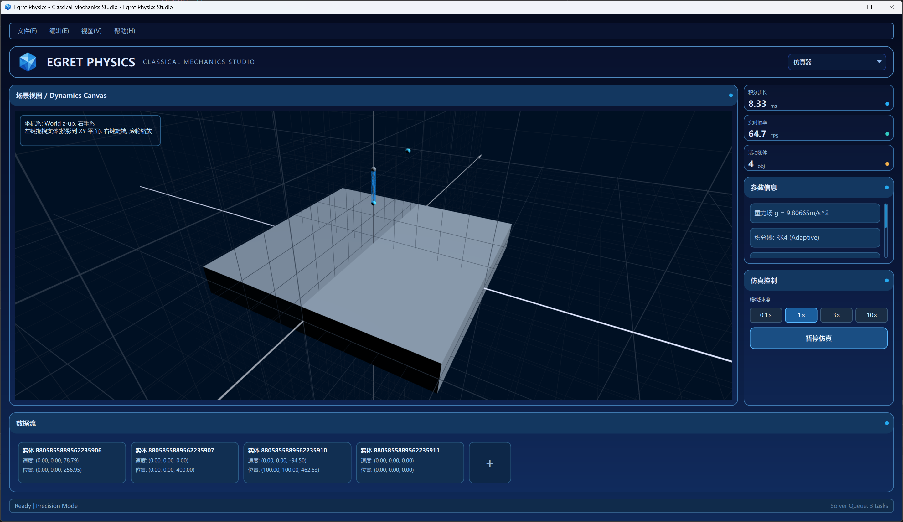

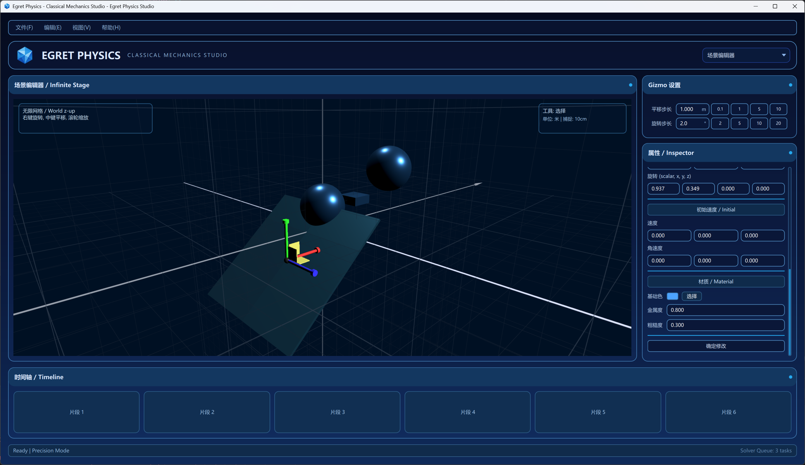

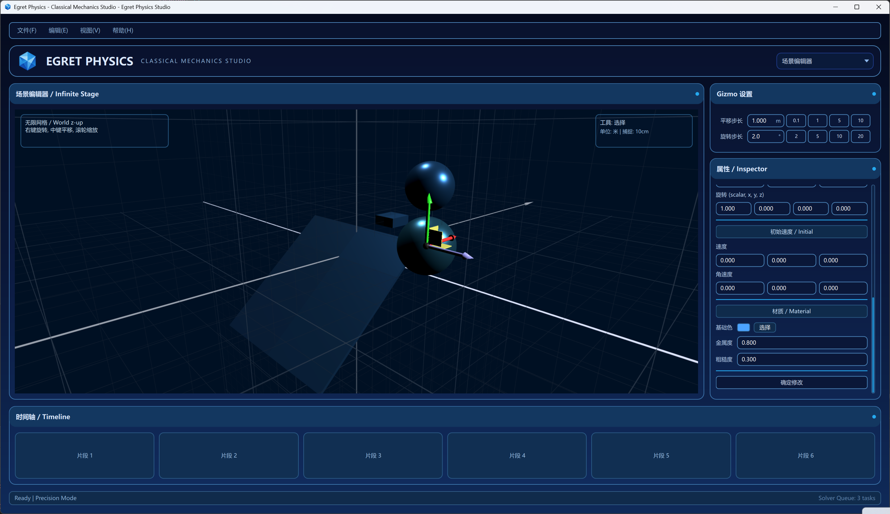

</details>

## 快速开始

以下命令在项目根目录的 **PowerShell** 中执行，假定已完成构建与运行库部署。

### 打开场景并完成第一次仿真

```powershell
./build/Release/Egret_Physics.exe --edit ./demo/programmable_body_control.epscene
```

在“编辑与求解”工作区检查场景和 C 程序，切换右侧“求解”，设置步长、采样间隔和仿真时长后开始求解。完成后保存 EPSX，切换“播放器”打开结果；“数据分析”可继续使用已打开的结果文件。

也可直接使用同一正式求解入口生成演示结果：

```powershell
./build/Release/Egret_Physics.exe --solve ./demo/programmable_body_control.epscene --duration 5 --step 0.5 --sample 10 -o ./build/control_demo.epsx
./build/Release/Egret_Physics.exe --play ./build/control_demo.epsx
```

**参数单位：`--duration` 为秒，`--step` 和 `--sample` 为毫秒。** 上例求解 5 秒、物理步长 0.5 ms、文件采样间隔 10 ms。物理步长、文件采样间隔、C 控制周期与分析抽帧比是四个不同设置。

### 一个 C 控制程序

在 UI 中绑定 `body`，添加数值参数 `force`；程序有效时段应覆盖撤销施力的时刻。

```c
/** @brief 一秒开始施力，三秒撤销，并各执行一次。 */
void on_step(void)
{
    Entity body = scene_entity("body");
    if (simulation_time() >= 1.0 && !state_bool("started")) {
        entity_set_force(body, vector3(parameter_number("force"), 0, 0));
        state_set_bool("started", true);
    }
    if (simulation_time() >= 3.0 && !state_bool("ended")) {
        entity_set_force(body, vector3(0, 0, 0));
        state_set_bool("ended", true);
    }
}
```

每段程序必须定义 `void on_step(void)`，默认已包含 SDK。用户可使用数值、结构体、分支、循环、自定义函数和全局状态；禁止递归、用户指针、数组下标、显式强制转换、任意外部头文件和系统调用。

所有程序读取同轮快照，动作在完整校验后提交；同一控制层的后写值覆盖前写值，多个力设置不会自动相加。停止回调不会撤销持久力，结束清理需要显式执行。

完整的 46 个 SDK 函数、配置、执行语义、资源限制和示例见 [受限 C 控制完整文档](docs/restricted_c_control_injection.md)。

### 更多命令行入口

```powershell
# 查看命令帮助
./build/Release/Egret_Physics.exe --help

# 解析 EPSX 的指定帧
./build/Release/Egret_Physics.exe --parse EPSX 348 ./build/control_demo.epsx

# 从 EPSX 导出视频
./build/Release/Egret_Physics.exe --export-video --input ./build/control_demo.epsx --output ./build/control_demo.mp4 --width 1920 --height 1080 --fps 30
```

### 可复用示例

| 文件 | 演示内容 |
| --- | --- |
| [programmable_body_control.epscene](demo/programmable_body_control.epscene) | 两段 C 程序：定时施力、创建替身与销毁原体 |
| [sliding_block_board.epscene](demo/sliding_block_board.epscene) | 滑块与受拉木板、摩擦和禁止转动的教学建模 |
| [sliding_block_board_thin.epscene](demo/sliding_block_board_thin.epscene) | 薄板极限与更小步长下的解析解对照 |
| [contact_plane_drag.epscene](demo/contact_plane_drag.epscene) | 带空气阻力的盒体／圆柱平面接触 |
| [chaotic_double_pendulum.epscene](demo/chaotic_double_pendulum.epscene) | 双摆场景 |
| [chaotic_triple_pendulum.epscene](demo/chaotic_triple_pendulum.epscene) | 三摆场景 |
| [demo_world.epscene](demo/demo_world.epscene) | 原有综合物理场景 |

## 文件格式与兼容性

| 文件 | 用途 | 当前保存方式 |
| --- | --- | --- |
| `.epscene` | V1.0 可编辑场景 | UTF-8 JSON；控制源码保存在字符串字段中 |
| `.epscenex` | V2.0 可编辑场景 | ZIP；根元数据、分类实体 JSON 和独立 C 源文件 |
| `.epsx` | 仿真结果 | 帧状态、场景描述及控制／动态身份等记录，用于回放和分析 |
| `.xlsx` / `.csv` | 导出数据 | 分析工作区抽取出的表格 |
| `.mp4` | 演示视频 | 对 EPSX 回放场景渲染、编码后的输出 |

新建场景默认保存为 `.epscenex`。打开旧 `.epscene` 后直接保存仍为旧格式；另存为 `.epscenex` 才转为 V2。读取器按内容识别格式，编辑器、模拟器和 `--solve` 共用读取路径。

```text
scene.epscenex
├── metadata.json              # magic="EPSCENE"，version="2.0"，场景设置与实体顺序
├── entities/
│   ├── general.json           # 一般实体
│   ├── fields.json            # 力场
│   └── constraints.json       # 约束
├── control/
│   ├── program_1.c
│   └── program_2.c
└── config/                    # 预留
```

归档元数据中的 `source` 保存包内相对路径，读取后恢复为源码字符串，不依赖归档外部文件。EPSX 1.1 支持动态身份、控制事件和材质记录；旧 EPSX 可继续读取，旧播放器则不保证理解新的动态生命周期。详见 [场景归档规范](docs/epscenex_format.md) 和 [EPSX 编码规范](docs/EPSX%20模拟数据文件编码格式规范.md)。

## 构建与依赖

### 开发环境

- Windows x64、PowerShell。
- Visual Studio 2026 Community，安装“使用 C++ 的桌面开发”和 MSVC x64 工具集。
- C++20，CMake **3.30.1 或以上**，与当前顶层 `CMakeLists.txt` 一致。
- Qt **6.9.3 msvc2022_64**，包含 Core、Gui、Widgets、Quick、Qml、Quick3D、Sql、Quick3DAssetImport、QuickControls2、Multimedia、Concurrent、PrintSupport。
- 构建依赖时还需脚本要求的 Ninja、下载和解包工具；Doxygen 文档可通过 `BUILD_DOCS` 开关控制。

当前 `CMakeLists.txt` 中的 Qt 前缀为 `D:/Qt/6.9.3/msvc2022_64`，其他机器需先调整该路径。仓库当前构建配置与预编译依赖以 Windows 为准。

### 准备第三方依赖

`dependency/` 体积较大，不随仓库完整提交。一般依赖可使用 [依赖重建脚本](dependency_build/README.md)：

```powershell
pwsh -NoProfile -ExecutionPolicy Bypass -File ./dependency_build/Build-Dependencies.ps1 -Step all
```

受限 C 控制依赖单独准备，参数需填写本机已有的 7-Zip 可执行文件路径：

```powershell
./tools/setup_control_dependencies.ps1 -ArchiveExtractor 'C:/Program Files/7-Zip/7z.exe'
```

FFTW 还需按当前 CMake 约定准备 `dependency/include/fftw/fftw3.h`、`dependency/lib/fftw/libfftw3-3.lib` 和 `dependency/bin/fftw/libfftw3-3.dll`；通用重建脚本当前没有单独的 FFTW 步骤。

| 依赖 | 项目使用版本／形式 | 用途 |
| --- | --- | --- |
| Qt | 6.9.3 | 界面、三维显示、任务及多媒体 |
| Boost / Eigen / magic_enum | 1.90.0 / 5.0.0 / 0.9.8 | 基础工具、线性代数及枚举 |
| CLI11 | 2.6.2 | 命令行参数 |
| Assimp | 6.0.2 | 网格资源导入 |
| QXlsx | 1.5.0 | Excel 输出 |
| muparser | 2.3.5 | 理论表达式求值 |
| QCustomPlot | 2.1.1 | 分析曲线绘制及交互 |
| FFTW | 项目内 Windows 预编译库 | 傅里叶变换 |
| FFmpeg | 9.0.2 shared 构建 | 视频编码与封装 |
| LLVM / Clang / LLD | 21.1.8 | 受限 C 校验与 Wasm 编译 |
| Wasmtime C API | 38.0.3 | Wasm 执行 |
| nlohmann/json | 3.12.0 | 控制配置与 AST JSON |
| JetBrains Mono | 随资源打包，附 OFL | C 编辑器默认字体 |

### 配置、构建与运行

在 PowerShell 中加载 Visual Studio 开发环境，然后配置并构建：

```powershell
& 'C:/Program Files/Microsoft Visual Studio/18/Community/Common7/Tools/Launch-VsDevShell.ps1' -Arch amd64 -HostArch amd64 -SkipAutomaticLocation
cmake -S . -B build -G 'Visual Studio 18 2026' -A x64
cmake --build build --config Release --target Egret_Physics
./build/Release/Egret_Physics.exe
```

| CMake 选项 | 默认 | 说明 |
| --- | --- | --- |
| `BUILD_TESTS` | `ON` | 配置测试目标 |
| `BUILD_DOCS` | `ON` | 查找 Doxygen 并配置文档生成 |

控制程序部署需要 `wasmtime.dll`、`control/bin/clang.exe`、`control/bin/wasm-ld.exe`、`control/sdk/`、`control/control_abi.h` 及 `control/licenses/`，构建流程会复制相关文件；完整应用还需 Qt、FFTW、FFmpeg 等运行库。路径和版本清单见 [控制依赖说明](docs/control_dependencies.md)。

### 独立控制核心

`Egret_Control_Core` 本身不链接 Qt，可单独构建验证；完整物理引擎仍通过原有适配路径运行。

```powershell
cmake -S src/control_core -B build/control-core -G 'Visual Studio 18 2026' -A x64
cmake --build build/control-core --config Release --target Egret_Programmable_Control_Tests
ctest --test-dir build/control-core -C Release --output-on-failure
```

## 测试与结果边界

近期迭代已增加针对接触、控制、编辑器、归档与场景时序的维护测试。按改动范围构建对应目标，再通过 CTest 执行；历史测试与新测试的状态应分别确认。

```powershell
cmake --build build --config Release --target Egret_Physics Egret_Control_Tests Egret_Contact_Tests Egret_Editor_Tests Egret_Scene_Archive_Tests Egret_Programmable_Control_Tests
ctest --test-dir build -C Release -R 'Egret(ControlTests|ContactTests|EditorTests|SceneArchiveTests|Programmable.*|EpscenexSolveTests|LoadTimeTests|SceneSettingsTests)$' --output-on-failure
```

| 验证入口 | 内容 |
| --- | --- |
| `EgretContactTests` | 接触、摩擦、约束、休眠、世界控制及回放生命周期 |
| `EgretEditorTests` | 编辑保存、引用重映射、撤销、预设和代码编辑相关行为 |
| `EgretControlTests` / `EgretProgrammableControl` | 规则后端和真实 C→Wasm 执行、状态、调度、限制与预算 |
| `EgretSceneArchiveTests` / `EgretEpscenexSolveTests` | V1/V2 场景归档与命令行求解 |
| `EgretProgrammableSceneTests` | 多程序、动态实体和 EPSX 结果 |
| `EgretLoadTimeTests` / `EgretSceneSettingsTests` | 加载时序、场景设置及对象绑定 |

本次 README 整理执行了 C 示例草稿检查、5 秒离线求解、动态回放跳帧及分析界面操作，未重新运行完整自动回归。截图不能代替误差测量；接触稳定性、能量误差及性能数据的适用条件见专项验证文档。

当前使用边界：

- 条件与 C 控制按步边界采样，连续弹簧／阻尼宜使用原有物理组件；控制结束需要显式撤销持久力。
- 动态生命周期回放已接入；动态实体的整段序列分析仍需单独验证，本文分析演示采用固定实体集合的历史结果。
- 频谱需要均匀、有限的样本，当前使用矩形窗；大数据绘图和双图交互耗时受机器及桥接路径影响。
- 复杂多体冲击、复杂约束组合以及全部 GUI 交互不由少量示例覆盖，需按实际场景验证。
- 智能体相关文档属于后续设计，不是当前已交付功能。

## 项目结构

```text
Egret Physics/
├── src/
│   ├── main.cpp                       # 应用入口
│   ├── control_core/                  # 无 Qt 控制编译、Wasm 执行与 ABI
│   │   └── sdk/                       # 公开受限 C 接口与可信运行库
│   ├── model/
│   │   ├── physics/                   # 刚体、力场和约束
│   │   ├── control/                   # 快照、动作缓冲和控制后端
│   │   ├── solver/                    # 求解器
│   │   ├── scene/                     # 世界管理与动态生命周期
│   │   └── strategy/                  # 积分、碰撞、接触和休眠策略
│   ├── view_model/                    # 编辑、求解、EPSX、回放、分析和视频导出
│   ├── qml/                           # Qt Quick 工作区及界面组件
│   ├── view/                          # 几何、资源及视图辅助
│   └── utils/                         # 日志、命令行和通用工具
├── demo/                              # 可运行场景与历史结果
├── resources/                         # 图标、预设、字体等资源
├── tests/                             # 核心与集成测试
├── tools/                             # 分析、生成及控制依赖准备工具
├── docs/                              # 设计、使用和验证文档
├── README.assets/                     # 当前演示及历史截图
├── dependency/                        # 本地第三方依赖
├── dependency_build/                  # 一般依赖重建脚本
├── subprojects/epscene_register/       # Windows 场景文件关联工具
└── CMakeLists.txt
```

<details>
<summary>查看历史物理模型继承关系图</summary>

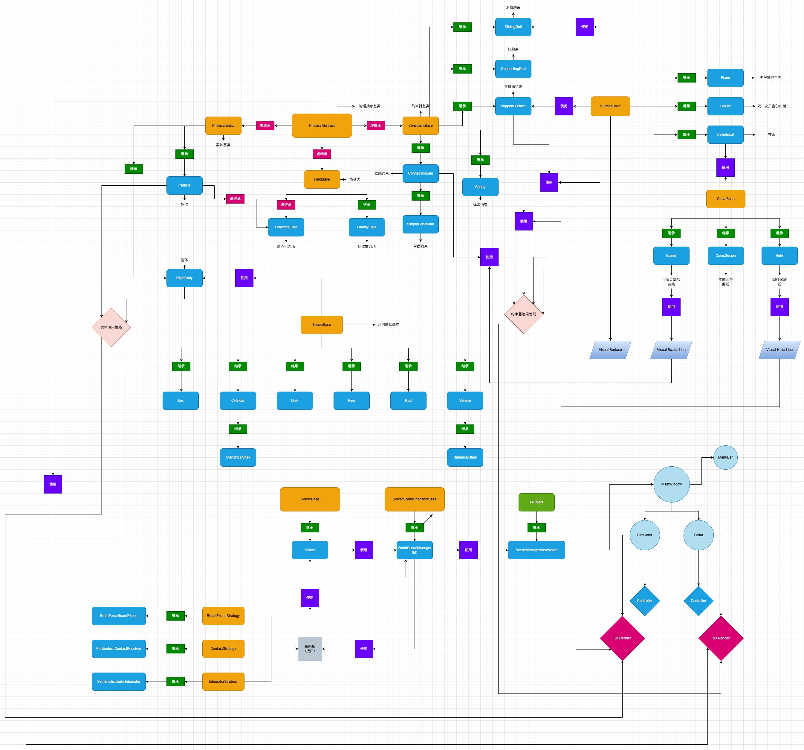

该图用于理解早期模型组织，新增控制核心与当前完整执行流程请结合源码和专项文档阅读。

</details>

## 文档导航

| 主题 | 文档 |
| --- | --- |
| 受限 C 完整手册 | [语言、全部 SDK、调度、生命周期、限制、排错](docs/restricted_c_control_injection.md) |
| C 控制快速使用 | [场景 C 控制使用说明](docs/programmable_scene_control_usage.md) |
| 控制验证与依赖 | [验证记录](docs/programmable_control_validation.md) · [依赖清单](docs/control_dependencies.md) |
| 编辑器与菜单 | [C 编辑器和预设](docs/code_editor_and_presets.md) · [菜单及快捷键](docs/menu_actions.md) |
| 场景格式 | [epscene / epscenex 兼容约定](docs/epscenex_format.md) |
| 结果格式 | [EPSX 编码规范](docs/EPSX%20模拟数据文件编码格式规范.md) |
| 接触求解 | [接触图设计](docs/ContactGraphSolverDesign.md) · [验证记录](docs/ContactGraphValidation.md) |
| 教学题复现 | [滑块木板解析与数值对照](docs/sliding_block_board.md) |
| 数据分析 | [分析工作区设计及历史实现记录](docs/数据分析工作区设计方案.md) |
| 视频导出 | [命令行、相机、编码及时间轴](src/view_model/video_export/README.md) |
| 一般依赖 | [依赖重建脚本说明](dependency_build/README.md) |
| 截图来源 | [场景、条件与本轮演示记录](README.assets/screenshot_notes.md) |

部分设计文档保留阶段性状态和未来规划。判断当前功能时，以本 README、当前 SDK、实现及相应验证记录为准。

## 日志与反馈

优先查看实际运行目录中的 `logs/qdebug_output.log`，包含 C++ `qDebug()` 和 QML 日志；信息不足时再看 `logs/async_logger.log`。常见位置是项目根目录、`build/Release/` 或用户自己的构建目录。

反馈问题时请提供程序路径、场景或结果文件、复现步骤、求解步长／采样间隔／时长，以及主日志最后 50 行。C 控制问题还需附程序名、源码、绑定和参数。项目内的诊断及修改流程见 [AGENTS.md](AGENTS.md)。

## 许可证与贡献

项目采用 **GNU GPL v3.0**，见 [许可证原文](GPL_v3.0.md)。第三方声明见 [NOTICE](NOTICE)，控制工具链声明另见 [控制依赖说明](docs/control_dependencies.md)，字体许可见 [OFL.txt](resources/fonts/OFL.txt)。各依赖以实际分发包附带许可为准。

项目还使用 [Transform Gizmo](https://github.com/YJHScenery/QtQuick3D-Transform-Gizmo) 和 [3D Coordinate](https://github.com/YJHScenery/Smart-3D-Coordinate-System) 等组件。

欢迎通过 Issue 和 Pull Request 提供场景、复现记录、算法改进和界面完善。修改前阅读 `AGENTS.md`：使用英文代码命名、中文解释和注释，新文件／类／函数编写中文 Doxygen 注释；以四空格缩进，按修改范围运行回归，并随接口或格式变化更新文档与示例。
